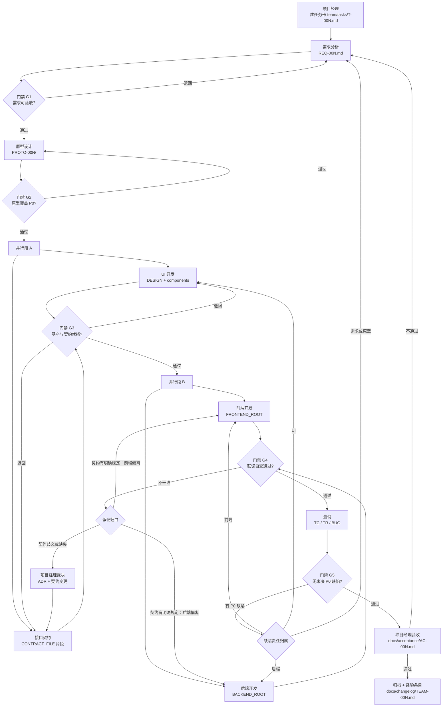
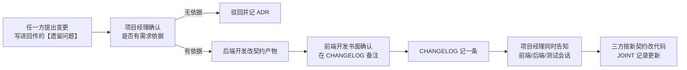

# AI 开发团队角色与协作流程

> **怎么用这份文档**
> 1. 先读第 1 章，把 6 条铁律抄进每个角色会话的开场信息里。
> 2. 按第 5 章建好目录，按第 1.4 / 1.5 节为每个项目建档（`stacks/<project>.md`），再按第 2 章给每个角色建固定会话。
> 3. 每次接活，照第 6 章的模板派活与回传；照第 3 章的门禁逐条核对。
> 4. 第一次只启用第 7 章"最小可用团队"，跑通 2 个任务后再扩。
> 5. 第 8 章打印出来贴在旁边，日常只看这一页。

---

## 0. 适用范围与两层结构声明

本文默认的运行前提：**单机、单仓库、无 CI/CD、无需求管理工具、无多人协作系统**。所有协作状态只存在于两处——磁盘上的文件，和项目经理会话里的对话记录。文件是唯一权威，对话不是。

**本手册不绑定任何技术栈。** 团队文件分两层：

| 层 | 回答什么问题 | 载体 | 谁维护 |
| --- | --- | --- | --- |
| 通用公约层 | 谁干什么、怎么流转、什么算完成、什么不许做 | `AGENTS.md` + 本手册 | 团队，长期稳定 |
| 技术栈档案层 | 本项目用什么框架、代码放哪、跑什么命令、有哪些硬性禁令 | `stacks/<project>.md` | 用户确认，每个项目一份 |

因此本手册里出现的任何目录、命令、格式，都只描述**交付物的语义**，不指定实现载体。涉及具体路径与命令时，用占位符表达，取值来自本项目档案：

| 占位符 | 含义 |
| --- | --- |
| `<PROJECT_STACK_FILE>` | 本项目技术栈档案路径，如 `stacks/nta.md` |
| `<FRONTEND_ROOT>` / `<BACKEND_ROOT>` | 前端 / 后端代码根目录 |
| `<COMPONENTS_DIR>` | 通用展示组件目录 |
| `<REQUEST_LAYER_DIR>` | 请求层目录 |
| `<CONTRACT_FILE>` | 契约唯一来源产物（手写文件或由注解生成的产物） |
| `<DDL_DIR>` | 表结构变更脚本目录 |
| `<FRONTEND_VERIFY_CMD>` / `<BACKEND_VERIFY_CMD>` | 前端 / 后端可执行的验证命令 |

两层结构与拓展机制见第 1.4、1.5 节；档案模板见 `stacks/_template.md`。

---

## 1. 团队总览与设计原则

### 1.1 为什么一个角色一个会话

| 原因 | 具体表现 | 不用分会话的后果 |
| --- | --- | --- |
| 上下文隔离 | 需求会话只装需求，不会被 300 行 SQL 和 5 个组件代码挤占 | 一个会话干所有事，早期需求细节在长上下文里被挤出窗口，后面开始"记错需求" |
| 角色稳定 | 每个会话的开场白固定，行为边界不漂移 | 同一个会话里既当测试又当开发，测试会不自觉放过自己写的 bug |
| 可追溯 | 谁在什么时候依据哪份文件做了什么，能对上 | 出了问题无法定位是哪个环节的判断失误 |
| 可替换 | 某个角色表现差，换掉这个会话即可，其他不受影响 | 只能整套推倒重来 |
| 成本可控 | 简单角色（测试）用小上下文，复杂角色（后端）给足上下文 | 所有会话都长上下文，费用与噪声一起涨 |

代价是"上下文不共享"。所以所有跨角色的信息必须**落盘**，靠文件传递，不靠会话之间的记忆。

### 1.2 用什么机制替代"人盯人"

个人开发者没有第二个人的时间来做监督，用四层机制替代：

1. **落盘即事实**：任何没有被写进仓库文件的结论，视为不存在。角色在会话里说"我已经改好了"不算完成，`git status` 里有变更才算。
2. **阶段门禁**：每个阶段出口有一张可勾选的清单（第 3.3 节），项目经理逐条核对文件是否存在、内容是否达标，不满足就退回，不靠感觉放行。
3. **固定回传格式**：每个角色任务结束必须按 7 字段模板回传（第 6.4 节），缺字段即视为任务未完成。这让"验收"变成填空题而不是阅读理解。
4. **契约先行**：前后端不靠口头约定对齐，靠契约产物 `<CONTRACT_FILE>` 对齐（手写契约文件，或由接口注解生成的产物，由档案 §3 定义）。契约是唯一裁判，减少大量"我以为你会返回这个字段"的沟通。

### 1.3 团队铁律（6 条，写进每个会话开场）

| # | 铁律 | 违反时的处理 |
| --- | --- | --- |
| R1 | **交付物必须落盘**。产出只写在约定路径下的文件里，会话里的结论必须同步进文件 | 项目经理验收时找不到文件，直接判未完成，不追问 |
| R2 | **契约先行**。没有契约产物（按档案 §3「接口契约的生成方式与产物」确定的唯一来源），前后端都不许开工写接口调用/接口实现 | 已写的代码作废重来，不计入进度 |
| R3 | **定义类角色先于实现类角色**。需求 → 原型 → 设计/契约 → 实现 → 测试，前一段没通过门禁，后一段不许启动 | 抢先做出来的东西默认丢弃，不允许"反正做完了就用吧" |
| R4 | **一个会话只做一个角色**。角色不越界，看到别人的问题只记录、不修改 | 越界修改的产物一律回退 |
| R5 | **不猜技术栈、不猜需求**。遇到未确认项，写进"待决问题"并交项目经理裁决，禁止自行选型或补全需求 | 擅自决策的部分需补 ADR，否则回退 |
| R6 | **提交由用户授权**。任何角色都不得自动执行 `git commit` / `git push`，只有用户明确要求时才提交 | 未经授权的提交一律由用户决定是否回退，团队侧不代为处理 |

### 1.4 两层结构：通用公约 + 技术栈档案

一个角色要服务多个项目，每个项目的技术栈可能完全不同。把某一套栈写进公约，等于让其他项目的角色按错的假设干活。所以拆两层：

| 层 | 内容 | 载体 | 变更频率 |
| --- | --- | --- | --- |
| 通用公约层 | 角色边界、交付物流转、门禁、契约管理原则、变更记录、协作机制、禁止事项 | `AGENTS.md`、本手册 | 低，跨项目稳定 |
| 技术栈档案层 | 框架与版本、代码目录、命令、分层与注册约定、数据层规则、硬性禁令、已知缺口 | `stacks/<project>.md` | 每个项目一份，随项目演进 |

三条配套规则：

1. **档案是事实来源**：任何"用什么框架、代码放哪、跑什么命令"的问题，只有档案能回答。手册与公约只写语义，不写实现载体。
2. **档案是用户资产**：新增项目、改字段、升级版本都需用户确认。角色发现档案与代码不符，只能回传 PM 并附证据（文件路径 + 行号或命令输出）。
3. **缺失即未确认**：档案不存在或关键字段为空时，角色必须停止并回传 PM，不得自行假设框架、目录或命令。

冲突裁定顺序（高 → 低）：**公约的流程与禁止事项 → 本项目档案 → 本手册的示例与建议**。即：档案可以在"用什么技术、代码放哪、跑什么命令"上覆盖手册的通用建议，但不能覆盖公约的流程与禁止事项（例如档案写"允许自动提交"，仍然禁止）。

### 1.5 技术栈拓展机制

**新增一个项目**

1. 复制 `stacks/_template.md` 为 `stacks/<新项目>.md`。
2. 逐字段填「取值」与「证据来源」；没证据的字段留空并标"未确认"，不写"应该""估计"。
3. 落到约定位置：默认 `stacks/`；若项目过大需与团队文件分仓，可放该项目根目录，但必须在任务卡与角色开场里写明路径，并按 `AGENTS.md` 第 6 节处理。
4. 为该项目建**独立角色会话**，开场说明里的 `<PROJECT_STACK_FILE>` 替换为真实路径。
5. 档案第一版经用户确认后才可派活；未确认的档案只能用于做技术调研类任务。

**同一项目内引入新技术栈**（如后端加一个服务、换 UI 库）

1. 先改档案对应字段，升版本号、写变更原因与依据。
2. 影响面超出单模块时，写 `docs/decisions/ADR-NNN.md`（背景 / 决策 / 替代方案 / 影响）。
3. 用户确认后 PM 才派活；任务卡"适用档案"里写明本次适用哪几个字段。
4. 过渡期允许新旧并存，但档案必须写清"新代码用新栈、旧代码不动"，避免角色各自改一半。

**多项目 / 多栈并行**

| 要求 | 说明 |
| --- | --- |
| 独立工作目录 | 每个项目一个仓库或工作目录，不共用 |
| 独立会话 | 禁止跨项目共用角色会话；项目 A 的上下文不得带进项目 B |
| 独立档案 | 每个项目一份，不合并 |
| 命名隔离 | 任务号按项目各自递增；跨项目沟通写"项目短名 + 任务号"（如 `nta/T-003`） |
| PM 视角 | 可由同一个主助理会话管多个项目，但每次派活必须说明项目与档案路径 |

**档案变更**

- 每次变更更新档案 §1 的「档案版本」与「最近更新日期」，并在 §12「变更记录」表追加一行（日期 / 版本 / 变更人 / 变更内容 / 影响角色 / 是否已通知）。
- 档案未更新但代码已变，视为**代码偏离档案**：要么按档案拦下，要么先补档案再继续；不允许"先干着，回头补"。

---

## 2. 角色说明书

每个角色一份说明书，存 `team/roles/<role>.md`，同时作为该会话的常驻开场内容。以下 7 个字段固定不变，不允许某角色自行增删字段。

### 2.0 项目经理（主助理会话）

- **定位**：唯一的信息中枢与验收人，负责派活、传话、裁决、汇总，**不写代码、不写需求、不写测试用例**。
- **核心职责**
  1. 把用户的一句话诉求拆成任务卡 `team/tasks/T-00N.md`，写清目标、范围、不做的事、验收依据、适用档案、涉及角色。
  2. 按第 3 章门禁逐条核对，决定"放行 / 退回"。
  3. 在角色之间转达信息，尤其是契约变更和需求变更。
  4. 裁决角色之间的冲突（契约歧义、需求冲突、责任归属）。
  5. 汇总阶段结论，产出验收记录 `docs/acceptance/AC-00N.md`。
- **输入**：用户原始诉求；各角色回传；仓库当前状态（文件、`git status`）。
- **输出**：`team/tasks/T-00N.md`（任务卡）、`docs/acceptance/AC-00N.md`（验收记录）、必要时 `docs/decisions/ADR-00N.md`（裁决记录）、`docs/changelog/TEAM-00N.md`（阶段汇总）。
- **完成标准（DoD）**
  - 任务卡 6 个字段齐全（目标 / 范围 / 不做 / 验收依据 / 适用档案 / 涉及角色），且"不做"至少 1 条。
  - 验收记录里每条验收条件都有 通过 / 不通过 / 未覆盖 之一，无空白项。
  - 所有角色回传的【遗留问题】都有明确处置（转派、降级为待决、或写 ADR）。
- **明确不负责**：不直接读代码做技术判断（只核对文件与清单）；不替角色补交付物；不擅自变更需求范围。
- **常见翻车点**
  - 任务卡只写"优化一下登录"，没写不做的事，导致前端顺手改了注册流程。
  - 验收时靠"看起来差不多"放行，没逐条对照 AC，缺陷在测试阶段集中爆发。
  - 把角色的口头汇报当成已完成，不去看文件，最后发现目录是空的。

### 2.1 需求分析

- **定位**：把模糊诉求翻译成可验收的需求条目，并明确划出"这次不做"的边界。
- **核心职责**
  1. 拆出需求条目，每条有唯一编号（`REQ-001-A1` 形式）、描述、优先级（P0/P1/P2）。
  2. 为每条 P0 需求写**可判断的验收条件**（含正常路径与至少 1 条异常路径）。
  3. 列出待决问题并标注决策人（默认项目经理，涉及用户的标注"待用户确认"）。
  4. 写清"本次不做"清单，防止范围蔓延。
  5. 定义领域词汇（同一事物只有一个叫法），供后续所有角色引用。
- **输入**：`team/tasks/T-00N.md`（项目经理的任务卡）；必要时项目经理转述的用户原话。
- **输出**：`docs/requirements/REQ-00N.md`
  - 章节固定：背景 / 需求条目表 / 验收条件 / 领域词汇 / 不做清单 / 待决问题。
  - 每条需求条目的字段固定：编号、描述、优先级、验收条件、涉及的页面或接口名。
- **完成标准（DoD）**
  - 每条需求都有编号、优先级、验收条件，三者缺一即不合格。
  - 验收条件里不出现"友好""合理""流畅"这类不可判断的词。
  - 每条 P0 需求至少 1 条异常路径（空值、越权、超限、并发 任选其一且写明）。
  - 待决问题 ≤ 5 条，且每条都有决策人和默认处理方式。
  - "不做清单"至少 1 条。
- **明确不负责**：不画界面、不定技术方案、不写接口字段类型、不排工期。
- **常见翻车点**
  - 把用户说的"要能搜索"直接写成需求，没定义搜索范围、排序、空结果表现，实现阶段各角色自由发挥。
  - 验收条件写成"用户可以正常登录"，无法判断什么叫正常。
  - 需求里混进了技术选型（"用缓存中间件存 token"），越界到后端职责。

### 2.2 原型设计

- **定位**：用可点击的静态页面把需求变成"看得见的东西"，并暴露需求里没想清楚的地方。
- **核心职责**
  1. 覆盖所有 P0 需求的页面与主流程，页面间可跳转。
  2. 标出关键状态：空数据、加载中、失败、无权限、超限，至少覆盖前 3 种。
  3. 标注每个页面的数据字段来源（字段名必须与需求条目里的叫法一致）。
  4. 标注每个页面依赖的接口（用业务语义命名，如"登录""订单列表"，不写 HTTP 方法与路径）。
  5. 把原型过程中发现的歧义回写为"待决问题"，交项目经理。
- **输入**：`docs/requirements/REQ-00N.md`。
- **输出**：`docs/prototype/PROTO-00N/`
  - `index.html`（单文件可点击原型，能双击打开，不依赖构建；样式可内联）
  - `notes.md`（页面清单、交互说明、状态说明、字段映射表、接口依赖清单、待决问题）
  - `screens/`（可选，关键页面截图，命名 `P1-登录.png`）
- **完成标准（DoD）**
  - `index.html` 双击即可打开，断网也能看，无外部 CDN 依赖。
  - P0 需求的每个页面都存在，且从首页可达（不超过 2 次点击）。
  - `notes.md` 中每个页面都有字段映射表，字段名与 REQ 中叫法一致。
  - 文案全部是真实业务文案，不出现 Lorem ipsum、"标题1"、"按钮"。
  - 待决问题 ≤ 3 条且有明确推荐方案（供项目经理裁决，而非把问题抛回去）。
- **明确不负责**：不做视觉规范（色板、字号系统）、不写组件代码、不定义接口出入参结构。
- **常见翻车点**
  - 原型只画"顺利路径"，没有空态和错误态，UI 开发阶段才临时编，导致前后不一致。
  - 用设计稿截图代替可点击原型，需求方无法验证流程，问题拖到测试才发现。
  - 顺手开始写前端组件，与 UI 开发的产物冲突。

### 2.3 UI 开发

- **定位**：把原型固化成可复用的视觉与组件基座，让业务页面不重复造轮子。
- **核心职责**
  1. 产出视觉规范（色板、字号、间距、圆角、阴影）并落为 `design-tokens.json`。
  2. 实现通用组件（按钮、表格、表单、弹窗、状态提示等），只接收 props，不调接口。
  3. 维护组件清单，写清每个组件的 props、事件、状态和适用场景。
  4. 处理响应式断点与基础无障碍（键盘可达、对比度、表单 label）。
  5. 产出"原型页面 → 组件"的对应关系，供前端开发直接组装。
- **输入**：`docs/prototype/PROTO-00N/index.html` + `notes.md`；`docs/requirements/REQ-00N.md`（取字段与文案口径）。
- **输出**
  - `docs/design/DESIGN-00N.md`（视觉规范 + 组件使用约定）
  - `design-tokens.json`（机器可读的 token）
  - `<COMPONENTS_DIR>`（取自档案；组件代码目录，按组件名分文件）
  - `docs/design/components.md`（组件清单：名称 / props / 事件 / 状态 / 对应原型页面）
- **完成标准（DoD）**
  - 组件目录内所有组件不 import 任何请求层或 store，纯展示。
  - `components.md` 中每个组件都有 props 表；无"见代码"式描述。
  - 组件里没有硬编码色值、字号，全部引用 `design-tokens.json`。
  - 原型中 P0 页面涉及的视觉元素，在 `components.md` 中都能找到对应组件或明确标注"一次性样式"。
  - 至少 3 个断点（示例：≥1200 / 768–1199 / <768）下无横向滚动条。
- **明确不负责**：不写业务页面与路由、不接接口、不改需求、不做后端相关的错误码文案最终定义（只给展示样式）。
- **常见翻车点**
  - 组件里直接写了网络请求，前端开发接手后无法替换为真实接口，只能复制一套。
  - 只在一种屏幕宽度下验证，窄屏下表格溢出，测试阶段被记为缺陷。
  - 视觉规范写在聊天里没落盘，前端开发各自取色，页面颜色不一致。

### 2.4 前端开发

- **定位**：把原型、组件、契约组装成可运行的真实页面，负责一切"用户能看到并操作"的部分。
- **核心职责**
  1. 实现页面、路由、状态管理，组装 UI 开发提供的组件。
  2. 按契约实现请求层：统一放在 `<REQUEST_LAYER_DIR>`，一个模块一个文件，出入参类型对齐契约产物 `<CONTRACT_FILE>`。
  3. 处理页面的加载 / 空 / 错误 / 无权限状态（不得只写顺利路径）。
  4. 完成与后端的联调自查（第 3.3 节 G4），提交联调记录。
  5. 维护"页面 → 接口 → 字段"映射表，供测试写用例。
- **输入**
  - `docs/prototype/PROTO-00N/`（交互与字段口径）
  - `docs/design/DESIGN-00N.md` + `docs/design/components.md` + `design-tokens.json`
  - 契约产物 `<CONTRACT_FILE>`（**唯一接口依据**）
  - `<PROJECT_STACK_FILE>`（框架、目录、启动与验证命令、硬性约定）
  - `docs/requirements/REQ-00N.md`（验收条件）
- **输出**
  - `<FRONTEND_ROOT>`（页面、路由、状态、组件组装）
  - `<REQUEST_LAYER_DIR>`（按契约实现的请求层）
  - `docs/frontend/IMPL-00N.md`（实现说明：页面 ↔ 接口 ↔ 字段映射表、未实现项及原因）
  - `docs/frontend/JOINT-00N.md`（联调记录：接口、请求样例、响应样例、结论）
- **完成标准（DoD）**
  - 档案中的前端启动命令与 `<FRONTEND_VERIFY_CMD>` 均实跑通过，首页可访问，控制台无 error（warning 需在 IMPL 中列明）。
  - 所有网络请求都在 `<REQUEST_LAYER_DIR>` 内，业务组件中无裸网络请求。
  - 每个调用的接口在 `<CONTRACT_FILE>` 中存在，字段名与契约一致（用映射表逐条对照，不留"应该一致"）。
  - REQ 中每条与前端的 P0 验收条件都有对应实现说明条目。
  - 空 / 错误 / 无权限 三种状态都能在页面上手动触发并看到明确反馈。
- **明确不负责**：不改契约字段（要改就走第 4 章流程）、不改后端代码、不写测试用例、不重新定义视觉规范。
- **常见翻车点**
  - 后端接口没就绪，自己编 mock 字段，联调时字段全对不上，等于重写。
  - 把接口错误码直接弹 `code: 500`，没做文案映射，测试记为体验缺陷。
  - 页面里直接操作 `localStorage` 存 token，与后端鉴权约定脱节，退出登录后仍能调接口。

### 2.5 后端开发

- **定位**：契约的主笔与守门人，提供数据、业务逻辑和错误码，同时保证数据库变更可回滚。
- **核心职责**
  1. 主笔接口契约：按档案 §3「接口契约的生成方式与产物」产出契约（手写文件或由注解生成的产物），提交前端开发审阅、项目经理裁决分歧。
  2. 实现接口、业务逻辑、鉴权、参数校验与错误码，并完成档案规定的接口注册步骤。
  3. 维护表结构变更脚本（可执行、可回滚），保持表结构与契约字段一致。
  4. 提供冒烟脚本，让前端和测试能自行验证接口可用。
  5. 维护错误码表（在契约中定义），并给出面向用户的中文文案建议。
- **输入**
  - `docs/requirements/REQ-00N.md`（业务规则与验收条件）
  - `docs/prototype/PROTO-00N/notes.md`（字段口径与页面依赖的接口语义名）
  - `<PROJECT_STACK_FILE>`（分层、注册步骤、契约方式、数据层规则、验证命令、硬性约定）
  - 既有契约 `<CONTRACT_FILE>` + `docs/api/CHANGELOG.md`（保持版本连续）
- **输出**
  - `<BACKEND_ROOT>`（接口、逻辑、鉴权、校验）
  - 契约产物 `<CONTRACT_FILE>`（手写契约文件，或由注解生成的产物）
  - `<DDL_DIR>`（表结构变更脚本，命名与目录按档案约定）
  - `docs/backend/IMPL-00N.md`（实现说明、业务规则落地位置、错误码表、已知限制）
  - `tests/smoke/*.sh` 或 `.http`（每个接口至少 1 条可复制的请求样例）
- **完成标准（DoD）**
  - 契约产物能按档案规定的"契约校验"方式通过（手写模式无语法错误、无悬空引用；生成模式重新生成后与注解无差异）。
  - 契约中每个接口都有：入参校验规则、成功响应、至少 2 个错误码。
  - 档案规定的接口注册步骤已完成（注册文件、注解、菜单或权限项），没有"能跑但没注册"的接口。
  - 每条表结构变更都能重复执行且可回滚（在本地空库跑通一次并记录在 IMPL）。
  - REQ 中每条后端相关验收条件都能在 IMPL 中找到对应实现位置（文件 + 函数名）。
  - `<BACKEND_VERIFY_CMD>` 实跑通过；冒烟脚本能在本地跑通，返回样例写入 `docs/frontend/JOINT-00N.md` 可复用的响应格式。
- **明确不负责**：不改需求、不写前端页面、不接管测试用例设计、不擅自为前端"顺手加字段"（加字段必须走契约变更）。
- **常见翻车点**
  - 先写代码后补契约，契约变成"实现的事后描述"，前端仍按旧版对接。
  - 契约里写了 `data: object`，没定义具体字段，前端只能猜，联调必然返工。
  - 改了表结构却没写回滚脚本，本地环境无法回退，后续变更越滚越乱。

### 2.6 测试

- **定位**：把验收条件转成可执行用例，独立判断"是否达标"，不改代码。
- **核心职责**
  1. 为每条 P0 验收条件写至少 1 条用例，编号 `TC-00N-01`。
  2. 覆盖异常路径：空值、越权、超限、重复提交、网络失败，按需求实际情况选取。
  3. 执行并输出报告，每条用例只有 通过 / 失败 / 阻塞 三态。
  4. 为每个失败项开缺陷单，写清复现步骤、期望、实际、责任角色。
  5. 回归：缺陷修复后重跑相关用例，并在报告里记录回归结果。
- **输入**
  - `docs/requirements/REQ-00N.md`（验收条件，唯一判定依据）
  - 契约产物 `<CONTRACT_FILE>`（接口行为预期）
  - `docs/frontend/IMPL-00N.md` + `docs/backend/IMPL-00N.md`（实现范围与已知限制）
  - 运行环境说明（由项目经理提供：档案里的启动命令、测试账号、测试数据）
- **输出**
  - `tests/cases/TC-00N.md`（用例表：编号 / 关联需求 / 前置 / 步骤 / 预期 / 类型）
  - `tests/reports/TR-00N.md`（执行报告：环境、时间、逐条结果、通过率、阻塞原因）
  - `docs/bugs/BUG-00N.md`（缺陷单，可一文件多单，单号 `BUG-00N-01`）
- **完成标准（DoD）**
  - 每条 P0 验收条件都有至少 1 条用例，映射关系在 TC 表"关联需求"列可见。
  - 异常路径用例 ≥ 总用例数的 30%（按条数算，不按感觉算）。
  - 报告中无空白结果项，阻塞项都写明阻塞原因和解除条件。
  - 每个失败项都有对应 BUG 单，且 BUG 单包含"复现步骤 / 期望 / 实际 / 责任角色"四项。
  - 报告结论明确写"可验收 / 不可验收"，不允许写"基本可用"。
- **明确不负责**：不改代码、不改需求、不替开发判断"这是设计如此"（有疑问写进报告由项目经理裁决）。
- **常见翻车点**
  - 只测顺利路径，越权、空字段全放过，上线后第一批问题都出在这里。
  - 发现缺陷直接在会话里描述，没开 BUG 单，开发改完后无人核对是否真修好。
  - 判定依据用"我觉得应该这样"，而没回看 REQ 的验收条件，导致争议无法收敛。

---

## 3. 协作流程

### 3.1 主流程



### 3.2 串行 / 并行与唯一事实来源

| 阶段 | 串行还是并行 | 唯一事实来源 | 说明 |
| --- | --- | --- | --- |
| 需求 | 串行 | `docs/requirements/REQ-00N.md` | 所有后续角色的争议都以它为准；它错了就全体返工，所以门禁最严 |
| 原型 | 串行 | `docs/prototype/PROTO-00N/`（`index.html` + `notes.md`） | 页面与交互口径以 `notes.md` 为准，截图只作辅助 |
| UI 开发 ∥ 契约编写 | **并行** | 各自产物：`docs/design/`、`<CONTRACT_FILE>` | 二者只依赖原型与需求，互不依赖，可同时开工；**不共享**任何中间结论 |
| 前端 ∥ 后端 | **并行** | `<CONTRACT_FILE>` 为接口唯一裁判；`REQ-00N.md` 为业务唯一裁判 | 并行前提是契约已冻结（G3 通过）。没有契约不许并行，只能串行等后端 |
| 联调 | 串行 | `<CONTRACT_FILE>` | 任何"代码跑通但契约没写"的行为都算未完成 |
| 测试 | 串行 | `REQ-00N.md` 的验收条件 + `<CONTRACT_FILE>` | 测试只认这两份，不认开发的口头解释 |
| 验收 | 串行 | 同上 + `TC/TR` 报告 | 项目经理按 AC 逐条判定 |

并行段的冲突规则：**并行角色之间不协商**。发现对方产物与自己理解不一致时，一律回传项目经理，由项目经理对照唯一事实来源裁决，不以"我们私下说好了"为准。

### 3.3 阶段门禁清单

每个门禁由项目经理逐条核对，全部为"是"才放行。

**G1 需求 → 原型**
- [ ] `docs/requirements/REQ-00N.md` 存在，且含背景 / 条目表 / 验收条件 / 领域词汇 / 不做清单 / 待决问题 六个章节。
- [ ] 每条需求都有编号、优先级、验收条件。
- [ ] 验收条件中无"友好 / 合理 / 流畅 / 尽量"等不可判断词。
- [ ] 待决问题都有决策人；"待用户确认"项已由用户答复或明确接受默认处理。
- 必答问题：这次交付的**最小可用范围**是哪几条 P0？哪几条明确不做？

**G2 原型 → 设计/契约**
- [ ] `docs/prototype/PROTO-00N/index.html` 双击可打开、可跳转，无外部依赖。
- [ ] P0 页面全覆盖，空态与错误态至少各出现一次。
- [ ] `notes.md` 含字段映射表与接口依赖清单。
- [ ] 原型阶段新发现的歧义已转为待决问题并给出推荐方案。
- 必答问题：每个 P0 页面依赖哪几个接口？字段名是否与需求叫法一致？

**G3 基座就绪 → 实现**
- [ ] `docs/design/DESIGN-00N.md`、`design-tokens.json`、`docs/design/components.md` 存在。
- [ ] 组件目录内无请求层依赖、无硬编码色值。
- [ ] 契约产物 `<CONTRACT_FILE>` 按档案规定的校验方式通过；覆盖所有 P0 页面所需接口。
- [ ] 每个接口有入参校验、成功响应、≥ 2 个错误码。
- [ ] 契约变更记录 `docs/api/CHANGELOG.md` 已建，有初始版本条目。
- 必答问题：契约是否冻结？谁审阅过？前端是否书面确认字段可用？

**G4 实现 → 测试**
- [ ] `docs/frontend/IMPL-00N.md`、`docs/backend/IMPL-00N.md` 存在且字段映射表完整。
- [ ] `docs/frontend/JOINT-00N.md` 有联调记录：每个接口的请求样例与真实响应样例。
- [ ] 档案里的前端启动命令、后端启动命令都能跑起来（项目经理本地实测一次）。
- [ ] `<FRONTEND_VERIFY_CMD>`、`<BACKEND_VERIFY_CMD>` 实跑通过，输出摘要已记录。
- [ ] 表结构变更在空库上跑通，回滚方式也实跑过。
- [ ] 无"代码已实现但契约未更新"的接口（逐个比对）。
- 必答问题：有没有实现范围外的临时行为？有没有绕过契约的硬编码 mock？

**G5 测试 → 验收**
- [ ] `tests/cases/TC-00N.md`、`tests/reports/TR-00N.md` 存在。
- [ ] 每条 P0 验收条件都有对应用例。
- [ ] 报告结论为"可验收"；P0 缺陷全部关闭或有明确延期记录。
- [ ] 所有 BUG 单状态明确（已修复 / 已验收 / 延期 / 判定非缺陷）。
- 必答问题：还有没有"已知但没写进任何文件"的问题？

### 3.4 返工回路

**缺陷回路（测试 → 实现）**

1. 测试在 `docs/bugs/BUG-00N.md` 开单，写"责任角色"字段（前端 / 后端 / UI / 需求 / 原型）。
2. 项目经理按责任角色把 BUG 单号转发给对应会话，只发单号与文件路径，不转述细节（避免二次失真）。
3. 角色修复后回传：改了哪些文件、对应 BUG 单号、自测方式。
4. 测试重跑用例，在 `TR-00N.md` 追加回归结果，BUG 单状态改为"已验收"或重新打开。
5. 一个 BUG 连续两次返工仍未关闭，项目经理必须写 ADR：是需求/契约本身有问题，还是该角色能力不足需要换会话。

**联调不一致回路（前端 ↔ 后端）**

判定顺序固定，不允许跳步：

1. 先看契约产物 `<CONTRACT_FILE>`。契约写清楚了 → 实现方按契约改，**以契约为准**，不争论"谁更合理"。
2. 契约写得不清楚或缺失字段 → 停手，不许自行商定。由任一方回传项目经理。
3. 项目经理裁决：明确字段/错误码/时序，更新契约产物（生成模式需重新生成），在 `CHANGELOG.md` 记一条变更，然后同时通知前端与后端会话。
4. 双方各自按新契约改，改完在 `JOINT-00N.md` 更新联调记录。

**需求变更回路（任何阶段 → 需求）**

- 变更只能由用户提出或项目经理转达。角色不得自行扩大范围。
- 变更写入 `REQ-00N.md` 的变更记录段（日期、条目号、变更内容、影响角色），并在 `docs/api/CHANGELOG.md` 或 `DESIGN-00N.md` 中同步影响说明。
- 已进入实现阶段的变更，项目经理需判断"改需求"还是"新开任务卡 T-00(N+1)"。跨范围的一律新开任务卡。

---

## 4. 接口契约与验收标准的落地约定

### 4.1 谁写、写在哪、什么格式

| 项目 | 约定 |
| --- | --- |
| 主笔 | 后端开发。原因：接口的入参校验、错误码、数据约束最终由后端落地 |
| 审阅 | 前端开发（字段是否够用、类型是否匹配页面）、UI 开发（错误码是否有对应展示样式）、测试（是否可据此写用例） |
| 裁决 | 项目经理。前端与后端意见冲突时由项目经理定，并写 ADR |
| 存放 | 由档案 §3「接口契约的生成方式与产物」决定：手写模式为入口文件 + 按模块拆分的片段（`docs/api/paths/<业务域>.yaml`，用 `$ref` 引用）；生成模式为接口注解 + 重新生成的产物。业务域名与页面或业务域一致 |
| 格式 | 手写模式以档案指定的契约格式为准（下方代码块仅为一种常见写法的示例）；生成模式以生成工具的注解规范为准。两种模式都必须写清：入参校验规则、成功响应、≥ 2 个错误码 |
| 变更记录 | `docs/api/CHANGELOG.md`，一条一行：日期 / 版本 / 接口 / 变更类型（新增·字段变更·废弃）/ 原因 / 影响角色 / 由谁通知 |
| 验收标准 | 写在 `REQ-00N.md` 的需求条目下，不在契约文件里写业务验收（契约只管接口行为） |

契约片段的写法建议（**手写模式**的示例，格式可按档案替换；生成模式则改注解、再重新生成）：

```yaml
# docs/api/paths/auth.yaml  —— 示例，技术栈无关
paths:
  /api/v1/auth/login:
    post:
      summary: 账号密码登录
      requestBody:
        required: true
        content:
          application/json:
            schema:
              type: object
              required: [username, password]
              properties:
                username: { type: string, minLength: 3, maxLength: 32 }
                password: { type: string, minLength: 8 }
      responses:
        "200":
          description: 登录成功
          content:
            application/json:
              schema:
                type: object
                required: [token, expiresIn, user]
                properties:
                  token:     { type: string }
                  expiresIn: { type: integer, description: 秒 }
                  user:
                    type: object
                    required: [id, name, role]
                    properties:
                      id:   { type: integer, format: int64 }
                      name: { type: string }
                      role: { type: string, enum: [admin, member] }
        "401":
          description: 账号或密码错误
          content:
            application/json:
              schema:
                $ref: "#/components/schemas/Error"
        "429":
          description: 尝试过于频繁
          content:
            application/json:
              schema:
                $ref: "#/components/schemas/Error"
```

### 4.2 契约变更流程（避免前后端各自发挥）



硬规则：

1. **改契约必须先改契约来源，再改代码。** 顺序反了就是"事后描述"，不算契约。生成模式下，"注解 + 重新生成"才算改完。
2. **接口只增不减**：废弃字段标 `deprecated: true` 并保留一个任务周期，不直接删除。
3. **通知必须走项目经理**，不允许前后端两个会话互相"我们已经说好了"。项目经理在 `CHANGELOG.md` 的"由谁通知"列打勾才算通知完成。
4. **契约冻结窗口**：G3 通过到 G5 通过之间，契约变更需项目经理签字（在 CHANGELOG 备注写"PM 批准"）。此窗口内任何未经批准的字段改动，视为缺陷。
5. **错误码统一由后端定义**，前端只做文案映射（映射表放 `docs/frontend/IMPL-00N.md`），不得自造错误码。

### 4.3 验收标准的落地

- 验收标准只有一处来源：`REQ-00N.md` 的"验收条件"。
- 测试据此写用例（TC 表"关联需求"列必须回指 REQ 编号）。
- 项目经理验收时按 AC 逐条打勾，写进 `docs/acceptance/AC-00N.md`，三态：通过 / 不通过 / 未覆盖。
- 验收条件如果需要修改（比如发现原条件不可测），走需求变更回路，不在验收现场口头放宽。

---

## 5. 交付物目录结构建议

```
repo-root/
├── team/                          # 团队协作区（不属于产品代码）
│   ├── roles/                     # 每个角色一份说明书，与固定会话一一对应
│   │   ├── pm.md
│   │   ├── req-analyst.md
│   │   ├── prototype.md
│   │   ├── ui-dev.md
│   │   ├── frontend-dev.md
│   │   ├── backend-dev.md
│   │   └── qa.md
│   └── tasks/                     # 任务卡，一个任务一个文件（项目经理产出）
│       ├── T-001.md
│       └── T-002.md
│
├── docs/
│   ├── requirements/              # 需求分析
│   │   └── REQ-001.md
│   ├── prototype/                 # 原型设计
│   │   └── PROTO-001/
│   │       ├── index.html
│   │       ├── notes.md
│   │       └── screens/
│   ├── design/                    # UI 开发
│   │   ├── DESIGN-001.md
│   │   ├── components.md
│   │   └── design-tokens.json
│   ├── api/                       # 契约辅助文件与变更记录（后端主笔，全队共用）
│   │   ├── <契约入口或片段目录>      # 手写模式才需要；生成模式为接口注解 + 生成产物
│   │   └── CHANGELOG.md
│   ├── frontend/                  # 前端开发
│   │   ├── IMPL-001.md
│   │   └── JOINT-001.md           # 联调记录
│   ├── backend/                   # 后端开发
│   │   └── IMPL-001.md
│   ├── bugs/                      # 测试
│   │   └── BUG-001.md
│   ├── acceptance/                # 项目经理
│   │   └── AC-001.md
│   ├── decisions/                 # 裁决与技术选型记录（项目经理）
│   │   └── ADR-001.md
│   └── changelog/                 # 阶段汇总
│       └── TEAM-001.md
│
├── stacks/                        # 技术栈档案（用户确认，每个项目一份）
│   ├── _template.md               # 档案模板，字段固定
│   └── <project>.md               # 如 nta.md
│
├── <FRONTEND_ROOT>/               # 前端代码：目录名与子结构由档案定义
│   ├── <COMPONENTS_DIR>/          # UI 开发产出，纯展示组件
│   └── <REQUEST_LAYER_DIR>/       # 前端开发产出，请求层，按契约组织
│
├── <BACKEND_ROOT>/                # 后端代码：目录名与分层由档案定义
│   └── <DDL_DIR>/                 # 表结构变更脚本（后端开发）
│
└── tests/
    ├── cases/                     # 测试用例表
    │   └── TC-001.md
    ├── reports/                   # 执行报告
    │   └── TR-001.md
    └── smoke/                     # 后端提供的冒烟请求样例
        └── auth.http
```

约定：

- 编号全局唯一、单调递增，跨任务不复用。`REQ`/`PROTO`/`DESIGN`/`IMPL`/`TC`/`TR`/`BUG`/`AC` 的编号与任务号 `T-00N` 对齐，便于回溯。
- 一个角色只写自己目录下的文件。跨角色引用只读不写。
- `<COMPONENTS_DIR>` 归 UI 开发，页面与 `<REQUEST_LAYER_DIR>` 归前端开发。这条边界最容易打架，写进两份说明书里；具体路径以档案为准。
- 目录存在即状态：`docs/requirements/REQ-001.md` 存在且通过 G1，才允许创建 `docs/prototype/PROTO-001/`。
- 树中带尖括号的条目是占位符，实际路径从 `<PROJECT_STACK_FILE>` 取；档案未写明的目录不创建。

---

## 6. 协作机制（会话层面）

### 6.1 会话组织

| 项 | 做法 |
| --- | --- |
| 会话数量 | 1 个项目经理会话 + 每个启用角色 1 个固定会话，会话标题写死角色名，如 `[角色] 后端开发` |
| 会话寿命 | 长期复用。一个任务结束后不清空，追加一行"T-00N 已验收"，再派下一个任务 |
| 上下文过载 | 单会话超过约 60% 上下文或出现"记错前面约定"时，用**交接摘要**重开同角色新会话（见 6.5） |
| 隔离 | 角色会话不互相@、不互相转发原始对话。跨角色只通过文件与项目经理 |
| 只读例外 | 角色可以只读其他角色的交付物文件（这是它的输入），但不能改 |

### 6.2 项目经理派活模板

派活只发这 7 项，不发长篇背景：

```
【任务】T-001
【目标】一句话说明这次要达成什么（可验收）
【范围】必须做的（列 3-5 条）
【不做】明确排除的（至少 1 条）
【适用档案】<PROJECT_STACK_FILE>（本次只看这几节：<列出>）
【输入】需要读的文件路径清单
【交付】需要产出的文件路径清单 + 完成标准（引用角色说明书 DoD）
```

补充规则：派活时不解释"为什么这么做"（背景在任务卡里）；不预先给出技术方案（那是角色的职责）；不夹带下一个任务。

### 6.3 角色会话开场固定信息

每个角色会话的第一段（或每次新开任务的第一条消息）必须包含这 6 项，阅读顺序固定为**公约 → 档案 → 手册**：

1. **角色说明书路径**：`team/roles/<role>.md`，要求会话先读它。
2. **通用公约与手册路径**：`AGENTS.md`、`AI开发团队角色与协作流程.md`。
3. **技术栈档案路径**：`<PROJECT_STACK_FILE>`，必须是真实路径，不留占位符；档案缺失时角色必须停止并回传。
4. **团队铁律**：第 1.3 节的 6 条，原文附上（防止会话漂移）。
5. **任务卡路径**：`team/tasks/T-00N.md`。
6. **输入文件清单与交付要求**：本次要读的具体路径（不给目录，给文件，避免乱翻）+ 产出路径 + DoD + 第 6.4 节回传模板。

可直接复制的开场说明母版见 `prompts/<role>.md`（pm / req-analyst / prototype / ui-dev / frontend-dev / backend-dev / qa）。落地时复制一份到 `team/roles/<role>.md`，两者内容保持一致，以 `team/roles/` 下的副本为准。

一条可复制的开场模板：

```
你是本项目的「后端开发」，只做这个角色。
按顺序读：先读 AGENTS.md（通用公约），再读本项目技术栈档案：
- <PROJECT_STACK_FILE>（如 stacks/nta.md）
再读 AI开发团队角色与协作流程.md（手册）、team/roles/backend-dev.md 和 team/tasks/T-001.md，以及下列输入：
- docs/requirements/REQ-001.md
- docs/prototype/PROTO-001/notes.md
- <CONTRACT_FILE>（路径见档案 §3「接口契约的生成方式与产物」）

团队铁律：交付物必须落盘 / 契约先行 / 定义先于实现 / 不越界 / 不猜需求与技术栈 / 不自动提交。
档案缺失或关键字段为空时，停止并回传，不要自行假设框架、目录或命令。
本次交付：
- 契约变更（按档案方式：手写片段或注解 + 重新生成）
- <BACKEND_ROOT> 下对应模块的接口实现
- docs/backend/IMPL-001.md
完成标准见角色说明书 DoD；不满足的条目请在回传中注明原因。
结束后按回传模板回复，不要只写"已完成"。
```

### 6.4 角色回传模板（7 字段，缺一视为未完成）

```
【任务】T-001
【门禁自检】对应门禁编号 + 逐条 通过 / 不通过（不通过写原因）
【改动文件】实际写入仓库的文件路径清单（必须能在仓库里找到）
【自测】怎么验证的（命令、请求样例、点击路径），以及结果
【遗留问题】未完成项、待决项，每条给推荐方案
【需要谁配合】需要哪个角色或项目经理做什么，没有写"无"
【风险】可能影响其他角色的事项（契约变更、字段调整、性能约束），没有写"无"
```

项目经理收到回传后做四件事：核对产物是否存在 → 逐条走门禁 → 处置遗留问题 → 决定放行或退回。回传里的"门禁自检"不能直接采信，必须对文件。

### 6.5 交接摘要（重开角色会话时用）

```
【角色】后端开发（第 2 个会话，接替会话 1）
【上下文】已完成 T-001/T-002；当前进行 T-003，卡在 <具体点>
【关键约定】契约风格 <简述>；错误码 <规则>；迁移编号已用到 0007
【必读】team/roles/backend-dev.md、docs/backend/IMPL-002.md、docs/api/CHANGELOG.md 最新 3 条
【下一步】<具体动作>
```

原则：交接摘要只写"新会话无法从文件里读到的信息"。凡是文件里有的，给路径就行，不复制内容——复制就会产生第二份事实来源。

### 6.6 项目经理自己的记录

- 每阶段结束写 `docs/changelog/TEAM-00N.md`：做了什么、谁交付的、门禁结果、遗留问题。
- 目的是让"当前进度"可被文件还原，而不是只能靠翻会话记录。这也是防止上下文丢失的唯一手段。

---

## 7. 分阶段启用建议

一次性开 7 个会话的问题是：门禁流程本身没人验证过，角色说明书里的漏洞会同时暴露在 7 个地方。

### 7.1 阶段划分

| 阶段 | 启用会话 | 验证目标 | 退出信号（满足才进入下一阶段） |
| --- | --- | --- | --- |
| **P0 最小可用** | 项目经理 + 需求分析 + 前端开发（**兼任原型与 UI 职责**，写进临时说明书）+ 后端开发 | 验证"任务卡 → 需求 → 契约 → 实现 → 验收"链路能否跑通；验证门禁是否可执行 | 连续 2 个任务：G1/G3 一次通过；验收记录无空白项；无需用户中途介入纠偏 |
| **P1 加测试** | ＋测试 | 验证独立测试角色能否挡住返工 | 连续 2 个任务：测试发现的缺陷中，≥ 50% 是 PM 自查漏掉的；P0 缺陷在验收前全部关闭 |
| **P2 加原型** | ＋原型设计（前端开发卸掉原型职责） | 验证原型能否减少"页面理解不一致"导致的返工 | 连续 2 个任务：因交互/文案理解偏差产生的缺陷 ≤ 1 条/任务 |
| **P3 加 UI** | ＋UI 开发（前端开发卸掉 UI 职责） | 验证组件复用是否真的成立 | 出现"同一视觉元素被实现第 3 次"或"页面间样式不一致"缺陷 ≥ 2 条，即说明该拆，此时才拆 |
| **P4 全量** | 7 个会话 | 稳定运行 | — |

注意 P0 的"兼任"处理：这是**明确的临时例外**，写进 `team/roles/frontend-dev.md` 的"临时兼岗"段，并在 P2/P3 拆分时删除该段。不要因为"兼着也能干"就永久不拆，也不要一上来就拆到 7 个。

### 7.2 最小可用团队配置

| 会话 | 角色 | 主要交付 |
| --- | --- | --- |
| 1 | 项目经理 | 任务卡、验收记录、ADR |
| 2 | 需求分析 | `REQ-00N.md` |
| 3 | 前端开发（兼原型/UI） | `PROTO-00N/`、`docs/design/`、`<FRONTEND_ROOT>` |
| 4 | 后端开发 | 契约产物、`<BACKEND_ROOT>` |

测试在 P0 由**项目经理按 `REQ-00N.md` 的验收条件手工点检**，记录写进 `docs/acceptance/AC-00N.md`。这不是省略验收，只是验收执行人暂时由项目经理兼任——一旦出现"自己验收自己放过"的迹象（同一缺陷两次逃过验收），立刻进入 P1。

### 7.3 推进节奏

1. 第一个任务刻意选**小且完整**的（示例：登录 + 列表页 + 1 个接口），目的是跑流程，不是做功能。宁可做小，也要走完 5 个门禁。
2. 第一个任务结束后，用半天时间修流程而不是修功能：把门禁里"实际没用到"的条目删掉，把"每次都漏"的条目挪进角色说明书开场。
3. 第二个任务起，逐步加一条硬要求（如"每个接口必须有 2 个错误码"），一次只加一条，避免同时改多个变量无法判断哪条有效。
4. 每个阶段结束写 `TEAM-00N.md` 复盘：哪个门禁拦住了问题、哪个门禁形同虚设。**形同虚设的门禁直接删**，留着只会让流程变长而不变可靠。

---

## 8. 一页速查表

| 角色 | 输入（来自谁 / 哪份文件） | 输出（文件） | 完成标准（一条判定） |
| --- | --- | --- | --- |
| 项目经理 | 用户诉求；各角色回传 | `team/tasks/T-00N.md`、`docs/acceptance/AC-00N.md`、`docs/decisions/ADR-00N.md` | 验收记录每条 AC 有 通过/不通过/未覆盖 三态之一，无空白 |
| 需求分析 | 项目经理 `T-00N.md` | `docs/requirements/REQ-00N.md` | 每条需求都有编号+优先级+可判断验收条件，且无模糊词 |
| 原型设计 | 需求 `REQ-00N.md` | `docs/prototype/PROTO-00N/`（`index.html`、`notes.md`） | `index.html` 断网双击可走通全部 P0 页面，且含空态与错误态 |
| UI 开发 | 原型 `PROTO-00N/`、需求字段口径 | `docs/design/DESIGN-00N.md`、`design-tokens.json`、`components.md`、`<COMPONENTS_DIR>` | 组件全部纯展示、无请求无硬编码色值，且 `components.md` 有完整 props 表 |
| 前端开发 | 原型 + 设计 + `<CONTRACT_FILE>` + REQ 验收条件 | `<FRONTEND_ROOT>`、`<REQUEST_LAYER_DIR>`、`docs/frontend/IMPL-00N.md`、`docs/frontend/JOINT-00N.md` | 无裸请求、字段与契约逐条对照一致、空/错/无权限三态可手动触发 |
| 后端开发 | REQ、原型 `notes.md`、契约审阅意见 | `<CONTRACT_FILE>`、`<BACKEND_ROOT>`、`<DDL_DIR>`、`docs/backend/IMPL-00N.md`、`tests/smoke/` | 契约按档案校验通过、每接口 ≥ 2 错误码、表结构变更可回滚且本地实跑过 |
| 测试 | REQ 验收条件、`<CONTRACT_FILE>`、两份 IMPL、环境说明 | `tests/cases/TC-00N.md`、`tests/reports/TR-00N.md`、`docs/bugs/BUG-00N.md` | 每条 P0 AC 有对应用例；失败项 100% 有 BUG 单；结论明确写可/不可验收 |

**门禁速查**：G1 需求可验收 → G2 原型覆盖 P0 → G3 基座与契约就绪 → G4 联调自查通过 → G5 无未决 P0 缺陷 → 验收。

**争议归口一句话**：契约问题找项目经理，业务问题看 `REQ`，视觉问题看 `DESIGN`，实现范围看 `IMPL`，技术栈事实看 `<PROJECT_STACK_FILE>`，都不许靠会话里"说好了"。
